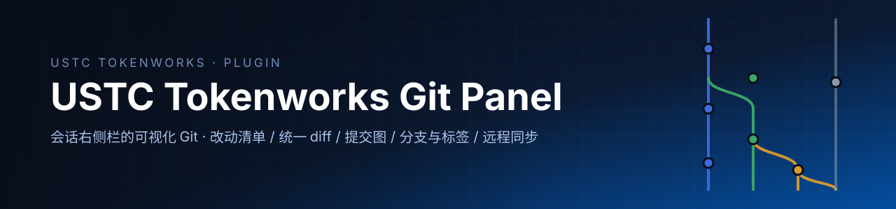

<p align="center">
  
</p>

<div align="center">

[](#从-git-安装) [](#从-git-安装) [](LICENSE)

[安装](#从-git-安装) · [用法](#用法) · [写操作](#写操作) · [配置](#配置) · [测试](#测试) · [问题反馈](https://github.com/charienustc/Tokenworks-git/issues/new)

</div>

USTC Tokenworks 的**会话右侧栏 Git 面板**：改动清单、统一 diff、提交图、分支与标签、远程同步与常用写操作，都在会话里就地完成，不用切到终端。

## 能做什么

| 能力 | 说明 |
| --- | --- |
| 改动清单 | 冲突 / 已暂存 / 未暂存 / 未跟踪四组，按目录分组折叠 |
| 统一 diff | 旧新行号槽、hunk 折叠、单行替换的词级高亮 |
| 暂存与提交 | 单文件 / 分组 / 全部三个粒度；提交框支持 Ctrl/⌘+Enter |
| 提交图 | 按 parents 计算泳道，行间连线连续；每行带引用 chip 与作者、日期、短哈希 |
| 分支与标签 | 本地分支 / 远程分支 / 标签 / 远程仓库四组，每行带短哈希、日期与提交标题；本地上游用 ↑/↓ 计数，远程仓库显示 fetch 地址；新建分支并直接切过去、切换、合并、安全删除 |
| 远程同步 | 获取、拉取（只做快进）、推送（首次发布自动 `-u`） |
| 撤销与重写 | 放弃改动、`revert`、`cherry-pick`、`reset --soft/--mixed`、检出任意提交 |
| 主题与语言 | 跟随 USTC Tokenworks 的浅色 / 深色；文案中英双语 |
| 输入框下的分支胶囊 | 不用打开面板就能看到当前分支与领先 / 落后，点开即可切换（切换前确认） |

面板不注册任何 agent 工具，也不依赖任何第三方库。

## 从 Git 安装

需要 **USTC Tokenworks**（Web 端）与 **git ≥ 2.23**（用到了 `git switch`）。

USTC Tokenworks 内：**设置 → 插件 → 安装**，粘贴：

```
https://git.ustc.edu.cn/Charien/tokenworks-git-panel.git
```

校外或连不上内网时，换成 `https://github.com/charienustc/Tokenworks-git.git`。

安装后**彻底退出 USTC Tokenworks（托盘右键退出，关窗口不算）再重新打开**——新的 host 插件只在启动时加载。

然后打开：右侧栏 `+` → **Git**，或点会话标题栏上的 Git 图标。

> 日常改代码：`client.js` 刷新页面即可，`index.js` / `lib/git.js` 要按上面那样彻底退出再打开。

## 用法

顶部状态条显示仓库名、分支、上游与领先 / 落后，右侧是刷新按钮。输入框下方还有一个常驻的分支胶囊，点开可以直接切换分支。

三个页签：

- **改动**：分组清单 + diff 面板 + 提交框。行上按需出现暂存 / 取消暂存 / 放弃，工具栏与分组头另有批量按钮。
- **历史**：提交图与引用 chip。工具栏有获取 / 拉取 / 推送；点进某个提交可拣选 / 还原 / 检出 / 重置，并查看该提交的完整改动。
- **分支**：本地分支 / 远程分支 / 标签 / 远程仓库四组。工具栏可新建分支与标签。

| 想做的事 | 在哪里 |
| --- | --- |
| 看某个文件的 diff | 改动 → 点文件名 |
| 暂存 / 取消暂存 / 放弃 | 改动 → 行右侧按钮，或工具栏 / 分组头的批量按钮 |
| 提交 | 改动 → 底部输入框，Ctrl/⌘+Enter |
| 切换 / 合并 / 删除分支 | 分支 → 对应分支行的操作按钮 |
| 新建分支 / 打标签 | 分支 → 工具栏 |
| 获取 / 拉取 / 推送 | 历史 → 工具栏 |
| 拣选 / 还原 / 检出 / 重置 | 历史 → 点进提交后的操作行 |
| 离开游离 HEAD | 分支 → 切回任意分支 |

会丢弃内容、删除引用或把 HEAD 移到别处的操作都先弹确认框：放弃、删除分支 / 标签、切换、检出、重置、还原、拣选、合并、拉取、推送。提交与新建分支直接执行，不弹框。

## 写操作

需要 `allowWrite: true`（默认），并在 Host 端串行执行。

| 操作 | git 命令 |
| --- | --- |
| 暂存 / 取消暂存 | `add --` / `restore --staged --`（失败时回退 `rm --cached --force`） |
| 提交 | `commit --message`（可选 `--no-verify`） |
| 放弃改动 | `restore --worktree --`（仅已跟踪文件） |
| 新建并切换分支 | `switch -c <name> [<start>]` |
| 切换分支 / 检出提交 | `switch <branch>` / `switch --detach <rev>` |
| 删除分支 | `branch -d` |
| 新建 / 删除标签 | `tag <name> [<rev>]` / `tag -d` |
| 获取 / 拉取 | `fetch --all --prune` / `pull --ff-only` |
| 推送 | `push`（该分支还没有上游时自动 `-u <remote> <branch>`） |
| 重置 | `reset --soft` / `reset --mixed` |
| 还原 / 拣选 / 合并 | `revert --no-edit` / `cherry-pick` / `merge --no-edit` |

不提供 `push --force`、`branch -D`、`checkout --force`、`reset --hard`、`rebase`，也不会删除未跟踪文件。

## 安全边界

- 每个请求先过 Host / Origin 与浏览器认证校验，再读任何仓库事实。
- 目录必须存在，且属于已注册的工作区。
- 用户输入只出现在单个 argv 位置——路径、分支 / 标签名、rev、提交信息、远端名——各自过白名单校验，不会被 git 当成选项；路径按字面处理。
- `allowWrite: false` 时 Host 直接拒绝写操作，不只是把按钮置灰。
- merge / cherry-pick / revert / pull 遇到冲突时原样显示 git 的错误，不自动 abort。

## 配置

在 profile 的 bundle 行里给 `@local/tokenworks-git-panel` 加 `config`：

| 键 | 默认 | 说明 |
| --- | --- | --- |
| `gitPath` | `"git"` | git 可执行文件 |
| `allowWrite` | `true` | 设为 `false` 后所有写入口禁用 |
| `commitNoVerify` | `false` | 提交时附加 `--no-verify`（跳过仓库钩子） |
| `timeoutMs` | `20000` | 读命令超时 |
| `writeTimeoutMs` | `120000` | 写命令超时（含网络操作） |
| `maxOutputBytes` | `8388608` | 单次命令收集输出上限 |
| `maxDiffBytes` | `524288` | 单个 diff 上限，也是未跟踪文件的读取上限 |
| `logLimit` | `200` | 提交图默认条数（请求上限 1000） |

## 仓库结构

| 路径 | 作用 |
| --- | --- |
| [`index.js`](index.js) | Host 半：17 个端点、信任栅栏、错误码到 HTTP 状态的映射、写操作串行队列 |
| [`lib/git.js`](lib/git.js) | git 适配器：命令表、porcelain v2 解析、名称 / rev / 路径守卫 |
| [`client.js`](client.js) | Client 半：页签、三个视图、diff 查看器、提交图、确认弹窗、样式 |
| [`cordis.patch.yml`](cordis.patch.yml) | bundle patch：把插件插进当前 profile |
| [`package.json`](package.json) | 包描述、`dsh` 清单、`pnpm test` 脚本 |
| [`icon.svg`](icon.svg) · [`locale/`](locale) | 插件图标；包级清单文案 |
| [`tools/`](tools) | 两套 smoke 测试（Host 半与 Client 半） |

## 测试

```
pnpm test          # 或：node tools/smoke.mjs && node tools/client-smoke.mjs
```

Host 68 条 + Client 131 条断言。前者对着临时仓库跑真实 git（含用本地裸仓库做远程同步的端到端），后者用微型 React 运行时渲染面板。

代码里没有平台专有分支，但**目前只在 Windows 上实测过**。受限沙箱里 git 的远程命令会因无法创建命名管道而显示 `SKIP`，不受限时真实执行。

## 许可

本仓代码采用 MIT，见 [LICENSE](LICENSE)。
