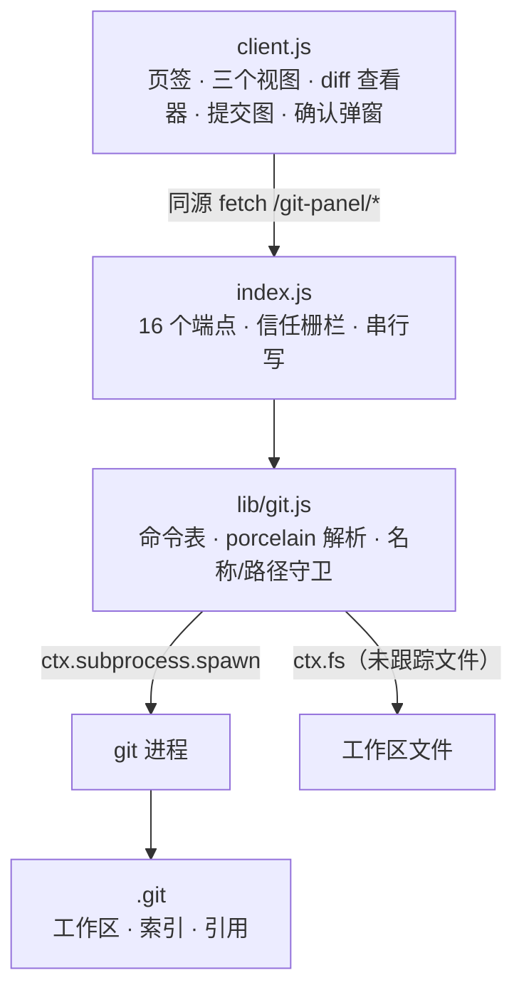
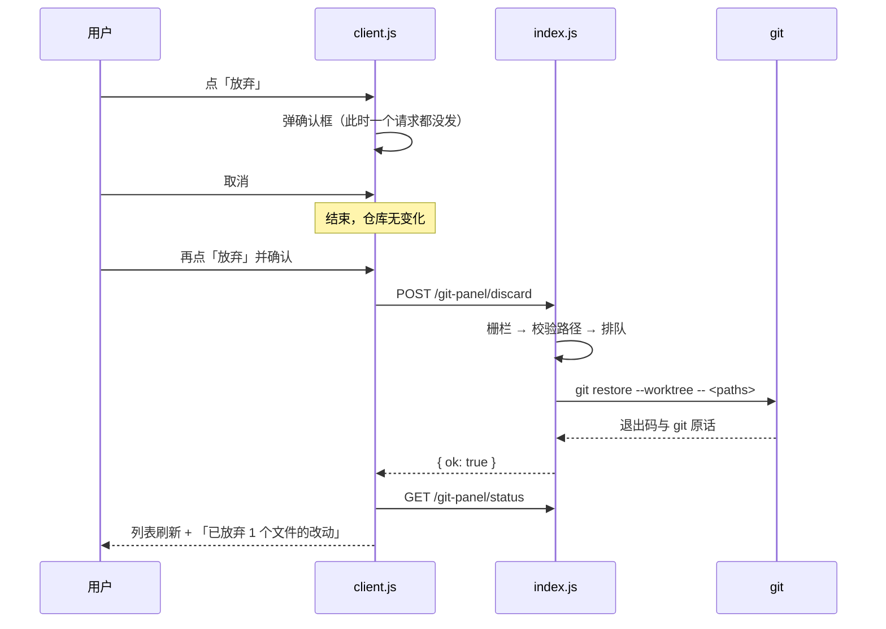

<p align="center">
  
</p>

<div align="center">

[](#安装) [](#安装) [](LICENSE)

[安装](#安装) · [用法](#用法) · [写操作](#写操作) · [安全边界](#安全边界) · [工作方式](#工作方式) · [测试](#测试) · [问题反馈](https://github.com/charienustc/Tokenworks-git/issues/new)

</div>

USTC Tokenworks 的**会话右侧栏 Git 面板**：改动清单、统一 diff、带泳道的提交图、分支与标签、远程同步，以及一整套受控的写操作——都在会话里就地完成，不用切到终端。

> [!NOTE]
> 写操作是一张**固定的命令表**，不是命令通道。没有 `push --force`、没有 `branch -D`、没有 `checkout --force`、没有 `reset --hard`、没有 `rebase`，也不会删除未跟踪文件。会移动 HEAD 或丢弃内容的动作都先弹面板内确认框。**破坏性能力是"不提供"，不是"再问一次"。**

## 能做什么

| | 能力 | 说明 |
| --- | --- | --- |
| 🗂 | **改动清单** | 冲突 / 已暂存 / 未暂存 / 未跟踪四组，按目录分组、目录可折叠，只有一个根目录时不显示多余的目录行 |
| 🧾 | **统一 diff** | 旧/新行号槽、hunk 折叠、单行替换的**词级高亮**；多文件补丁分节列出并标 `+增 −删` |
| ✅ | **暂存与提交** | 单文件 / 整个分组 / 全部三个粒度；提交框支持 **Ctrl/⌘+Enter**，按钮直接写明"提交 n 个文件" |
| 🌳 | **提交图** | 按 parents 计算泳道：行与行的连线**连续**、拐弯圆角、提交点是实心彩点；每行带引用 chip 与 `作者 · 日期 · 短哈希` |
| 🏷 | **分支与标签** | 新建分支（建完直接切过去）/ 切换 / 合并 / 安全删除；标签新建与删除；远程仓库一览 |
| ☁️ | **远程同步** | 获取（`fetch --all --prune`）、拉取（`pull --ff-only`）、推送（首次发布自动 `-u`） |
| ⏪ | **撤销与重写** | 放弃改动、`revert`、`cherry-pick`、`reset --soft/--mixed`、检出任意提交（进游离 HEAD） |
| 🔔 | **反馈** | 每个写操作后刷新状态并给通知条（成功 4 秒、失败 8 秒自动消失），取消确认框则一个请求都不发 |
| 🌗 | **主题与语言** | 只用 `--dsw-alias-*` 主题 token，浅色/深色跟随 USTC Tokenworks；文案全部走 `ctx.locale`，中英双语 |
| 🙈 | **只给人看** | 面板不注册任何 agent 工具——它服务的是坐在会话前的人 |
| 📦 | **零依赖** | `package.json` 没有任何 dependencies；浏览器侧只 `require('react')`，Host 侧只用 USTC Tokenworks 提供的服务 |
| 🔌 | **可卸载** | 每个注册都由 `ctx.effect` 持有，禁用插件即回收页签、标题栏按钮与样式表 |

## 安装

1. 需要 **USTC Tokenworks**（Web 端）与 **git ≥ 2.23**（用到了 `git switch`）。
2. 把本仓装成工作区插件（会写入当前 profile，需要批准）：

   ```
   plugin_manager install_bundle  target = F:\dsh-git
   ```

3. 在会话里打开：右侧栏 `+` → **Git**，或点会话标题栏上的 Git 图标。工作区不是 git 仓库时会明确提示。

> [!TIP]
> 改了插件代码要重新加载才对页面生效：Client 半（`client.js`）刷新页面即可（必要时重启 USTC Tokenworks 载入新一代模块），Host 半（`index.js` / `lib/git.js`）需要重启 USTC Tokenworks。

## 用法

顶部是仓库状态条（仓库名、分支 chip、上游与 ↑领先 / ↓落后、刷新按钮，忙碌时旋转），下面三个页签：

- **改动**：分组清单 + diff 面板 + 提交框。工具栏有**全部暂存 / 全部取消暂存 / 全部放弃**，分组头有自己的批量按钮，行上按需出现**暂存 / 取消暂存 / 放弃**。
- **历史**：提交图与引用 chip；工具栏有**获取 / 拉取 / 推送 / 全部引用**；点进某个提交可**拣选 / 还原 / 检出 / 软重置 / 混合重置**，并查看该提交的完整改动。
- **分支**：本地分支 / 远程分支 / 标签 / 远程仓库四组；工具栏可**新建分支**、**新建标签**（内联表单，回车即提交）。

| 想做的事 | 在哪里 |
| --- | --- |
| 看某个文件的 diff | 改动 → 点文件名 |
| 暂存 / 取消暂存 / 放弃 | 改动 → 行右侧的胶囊按钮，或工具栏 / 分组头的批量按钮 |
| 提交 | 改动 → 底部输入框，**Ctrl/⌘+Enter** |
| 切换 / 合并 / 删除分支 | 分支 → 对应分支行的操作胶囊 |
| 新建分支 / 打标签 | 分支 → 工具栏（可填名称与可选起点 / 指向） |
| 获取 / 拉取 / 推送 | 历史 → 工具栏 |
| 拣选 / 还原 / 检出 / 重置 | 历史 → 点进提交后的详情操作行 |
| 离开游离 HEAD | 分支 → 切回任意分支 |

> [!IMPORTANT]
> 会移动 HEAD、改动工作区或丢弃内容的操作，**都先弹确认框**；取消则不会发出任何请求。确认框会写清后果，例如放弃改动是"无法恢复"、删分支是"只做安全删除"、拉取是"只做快进式，不会创建合并提交"。

## 写操作

全部写操作都需要 `allowWrite: true`（默认），并在 Host 端**串行执行**——两条写命令不会同时去抢 git 的 index 锁：

| 操作 | git 命令 |
| --- | --- |
| 暂存 / 取消暂存 | `add --` / `restore --staged --`（无 HEAD 时回退 `rm --cached --force`） |
| 提交 | `commit --message`（可选 `--no-verify`） |
| 放弃改动 | `restore --worktree --`（**仅已跟踪文件**） |
| 新建并切换分支 | `switch -c <name> [<start>]` |
| 切换分支 / 检出提交 | `switch <branch>` / `switch --detach <rev>` |
| 删除分支 | `branch -d`（从不 `-D`） |
| 新建 / 删除标签 | `tag <name> [<rev>]` / `tag -d` |
| 获取 / 拉取 | `fetch --all --prune` / `pull --ff-only` |
| 推送 | `push`（该分支还没有上游时自动 `-u <remote> <branch>`） |
| 重置 | `reset --soft` / `reset --mixed` |
| 还原 / 拣选 / 合并 | `revert --no-edit` / `cherry-pick` / `merge --no-edit` |

> [!WARNING]
> 面板**故意不提供**这些操作：`push --force`、`branch -D`、`checkout --force`、`reset --hard`、`rebase`，以及删除未跟踪文件。它们都会不可逆地丢掉工作，宁可不做，也不加一个"确认"了事。放弃功能对未跟踪文件会明确拒绝并说明原因——那是删文件，不是还原。

## 安全边界

- **信任栅栏**：每个请求先过 `connection.requestRejection`，Host/Origin 校验与浏览器认证发生在**拿到任何仓库事实之前**。
- **工作区栅栏**：目录必须存在，且在已注册工作区之内（`workspaceRegistry` 存在时才生效）。
- **固定参数表**：用户输入只出现在路径、分支名、标签名、rev 四个位置，且都过本地白名单校验——ref 名不允许空格、`~^:?*[`、`..`、`@{`、结尾 `/` 或 `.lock`；rev 只允许 `[0-9a-zA-Z^~_./-]`。**没有把任意参数透传给 git 的通道。**
- **串行写 + 超时**：写命令排队执行，用更长的 `writeTimeoutMs`（网络操作可能慢）。
- **只读栅栏**：`allowWrite: false` 时 Host 直接拒绝，不只是把按钮置灰。
- **冲突不代你决定**：merge / cherry-pick / revert / pull 遇到冲突时原样显示 git 的错误，**不自动 abort，也不替你选边**；解决后照常用面板暂存与提交。
- **未知的界面**：仓库没有配置 `user.name` / `user.email` 时提交按钮禁用并给出提示，而不是等你写完信息才失败。

## 工作方式

浏览器只是渲染层，所有 git 调用都在 Host。Client 通过**同源** `fetch` 访问 `/git-panel/*` 的 16 个端点：



一次破坏性写入的完整路径——**确认发生在请求之前**：



选这条 Host/Client 配对方式（同源 HTTP + 纯 JS bundle），而不是 typert 的 `@Remote`，是因为代码生成产物对一个纯 JS 插件太重——这也是上游自带的 open-in-app 插件那一对的做法。

## 配置

在 profile 的 bundle 行里给 `@local/tokenworks-git-panel` 加 `config`：

| 键 | 默认 | 说明 |
| --- | --- | --- |
| `gitPath` | `"git"` | git 可执行文件；交给 `ctx.subprocess.resolveExecutable` 解析 |
| `allowWrite` | `true` | 设为 `false` 后所有写入口禁用，Host 端也会拒绝 |
| `commitNoVerify` | `false` | 提交时是否附加 `--no-verify`（跳过仓库钩子） |
| `timeoutMs` | `20000` | 读命令超时 |
| `writeTimeoutMs` | `120000` | 写命令超时（含网络操作） |
| `maxOutputBytes` | `8388608` | 单次命令收集输出上限 |
| `maxDiffBytes` | `524288` | 单个 diff 上限，也是未跟踪文件的读取上限 |
| `logLimit` | `200` | 提交图默认条数（请求上限 1000） |

## 仓库结构

| 路径 | 作用 |
| --- | --- |
| [`index.js`](index.js) | Host 半：16 个端点的注册、信任栅栏、错误码到 HTTP 状态的映射、写操作串行队列 |
| [`lib/git.js`](lib/git.js) | git 适配器：28 个方法、porcelain v2 解析、引用名/路径守卫、只读栅栏 |
| [`client.js`](client.js) | Client 半：页签类型与标题、三个视图、diff 查看器、提交图、确认弹窗、整套样式 |
| [`cordis.patch.yml`](cordis.patch.yml) | bundle patch：把插件插进当前 profile |
| [`package.json`](package.json) | 包描述、`dsh` 清单（client 注入项）、`pnpm test` 脚本 |
| [`icon.svg`](icon.svg) · [`locale/`](locale) | 插件图标；包级清单文案（中文 / English） |
| [`tools/smoke.mjs`](tools/smoke.mjs) | Host 半 smoke：对着临时仓库跑真实的 git |
| [`tools/client-smoke.mjs`](tools/client-smoke.mjs) | Client 半 smoke：微型 React 运行时渲染面板 |

## 测试

```
pnpm test          # 或：node tools/smoke.mjs && node tools/client-smoke.mjs
```

| 套件 | 断言 | 覆盖 |
| --- | --- | --- |
| [`tools/smoke.mjs`](tools/smoke.mjs) | 51 | 暂存 / 提交 / diff / 历史 / 分支 / 标签 / 放弃 / reset / 还原 / 拣选 / 合并、引用名与路径守卫、只读栅栏；远程同步用**本地裸仓库**做端到端 |
| [`tools/client-smoke.mjs`](tools/client-smoke.mjs) | 90 | 分组与目录折叠、diff 行号 / 词级高亮 / hunk 折叠、**提交图几何**、暂存与放弃、确认弹窗的"确认"与"取消"两条路径、分支与标签表单、同步按钮、空态与错误重试、按钮描边约定 |

> [!NOTE]
> **两处如实标注的边界。**
> 一是**平台**：代码里没有平台专有分支（路径分隔符在解析层归一），但**目前只在 Windows 上实测过**，macOS / Linux 未经真机验证。
> 二是**远程往返**：在本机沙箱里，git 调远程命令时会 fork `sh.exe`，而沙箱禁止创建命名管道（`couldn't create signal pipe, Win32 error 5`），所以 push / pull / fetch 的**端到端**那一项会显示 `SKIP` 而不是假装通过——它们仍按**调用参数形状**被断言。在不受限的终端里重跑即可执行真实往返。

## 许可

本仓代码采用 **MIT**，见 [LICENSE](LICENSE)。可自由使用、修改、分发，包括闭源商用，只需保留版权声明。

本项目的实现全部自行完成，**不含任何第三方库**：Host 只使用 USTC Tokenworks 提供的 `ctx.subprocess`、`ctx.fs`、`ctx.webServer`、`ctx.connection` 与 `ctx.locale`；浏览器侧只 `require('react')`。
